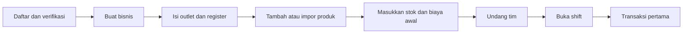
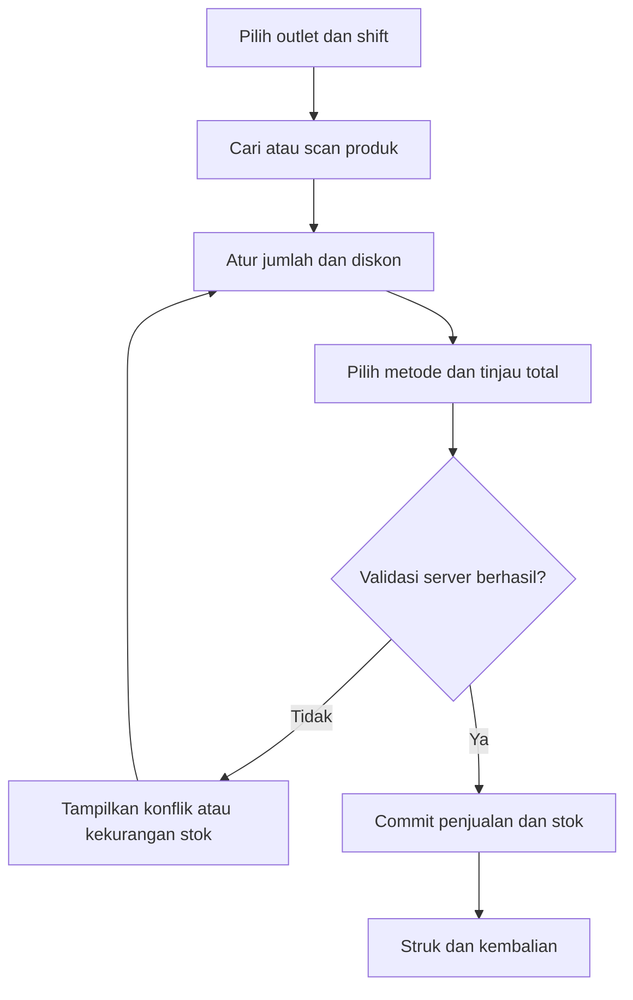
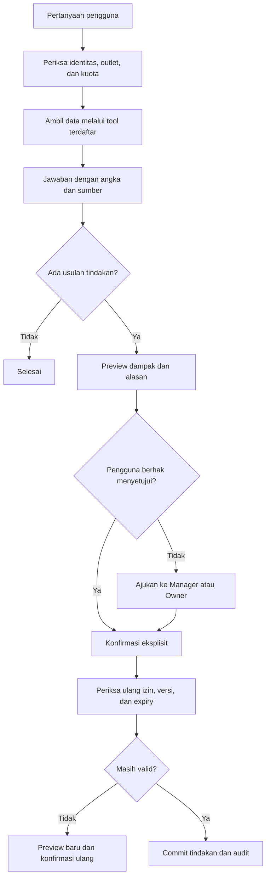
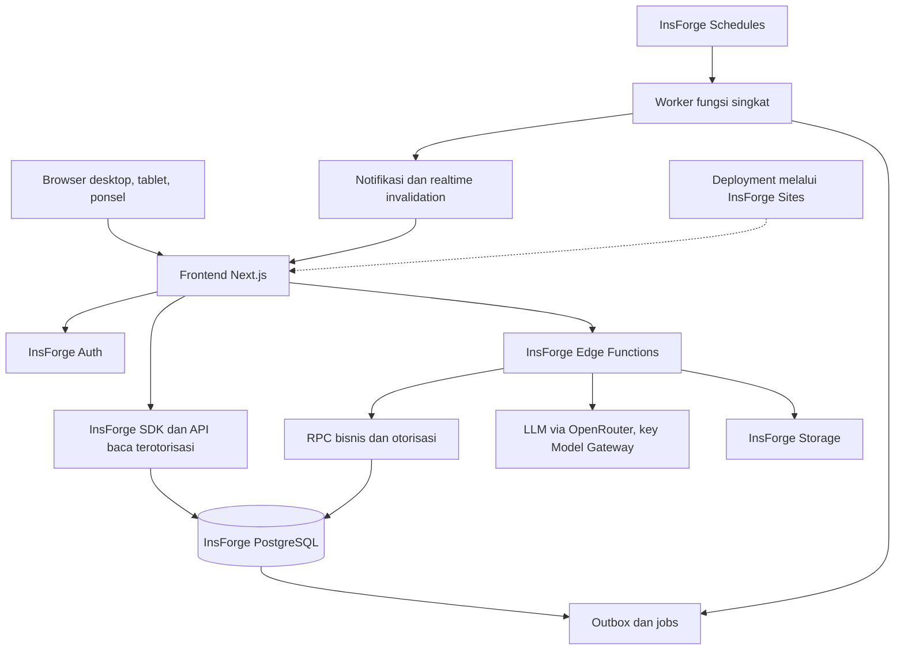
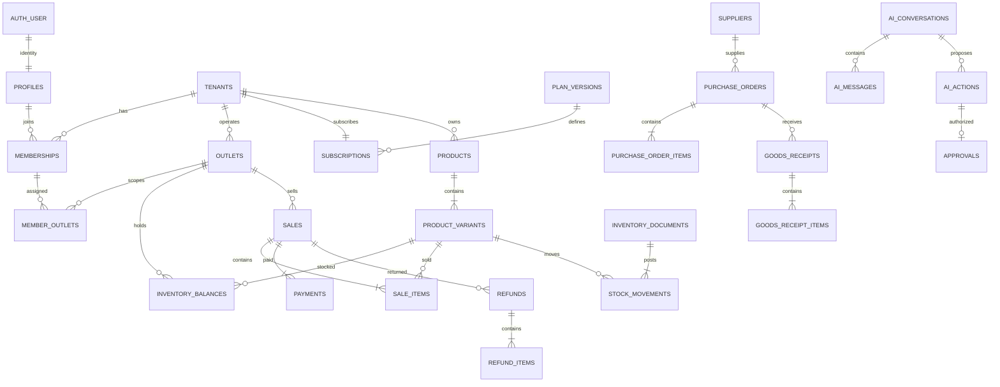

# Nusa: SaaS POS, Inventory & AI Agent

Product Requirements Document | Versi 1.0 | 11 September 2026

**Status: draft lengkap untuk ditinjau, sebelum implementasi backend dan deployment.**

Nama Nusa mengikuti prototipe dalam proyek dan merupakan nama kerja. Dokumen ini mendefinisikan produk yang akan dibangun, bukan menyatakan bahwa seluruh fitur telah tersedia. Stack yang ditetapkan pengguna: frontend Next.js, backend InsForge, PostgreSQL yang dikelola InsForge, dan deployment melalui InsForge.

## 1. Overview produk

Nusa adalah aplikasi kasir dan pengelolaan persediaan berbasis langganan untuk usaha ritel/UMKM Indonesia. Pemilik dapat mengelola beberapa outlet, mencatat penjualan dan pembelian, memantau stok serta kinerja usaha, dan bekerja bersama tim dengan hak akses berbeda.

AI agent menjadi pendamping operasional yang memahami data usaha: menjawab pertanyaan, menjelaskan perubahan penjualan, menemukan stok yang perlu diisi, membuat draft purchase order, dan mengusulkan koreksi stok. Setiap angka bisnis dihitung oleh layanan data. AI menyajikan penjelasan dan rencana tindakan; perubahan data dilakukan hanya melalui fungsi bisnis yang terotorisasi dan konfirmasi pengguna.

### 1.1 Masalah dan hasil yang dituju

| Masalah pengguna | Hasil yang diharapkan |
| --- | --- |
| Pencatatan penjualan dan stok terpisah | Penjualan yang berhasil langsung memperbarui persediaan dan laporan dalam satu transaksi database. |
| Stok habis baru diketahui saat melayani pelanggan | Daftar stok minimum dan rekomendasi restock tersedia per outlet. |
| Pemilik harus membaca banyak laporan | Pertanyaan berbahasa Indonesia menghasilkan ringkasan dengan periode, outlet, dan sumber angka. |
| Operasional cabang sulit dipantau | Dashboard terpusat dengan pembatasan akses per bisnis dan outlet. |
| Koreksi stok dan refund sulit ditelusuri | Setiap perubahan mempunyai alasan, pelaku, persetujuan, serta catatan audit. |

### 1.2 Asumsi produk

| Keputusan awal | Batas asumsi |
| --- | --- |
| Segmen pertama: ritel barang jadi | Toko kelontong, minimarket kecil, toko pakaian, aksesori, dan produk kemasan. Alur dapur/restoran belum termasuk. |
| Aplikasi web responsif | Desktop/tablet untuk kasir; ponsel untuk monitoring dan operasi sederhana. |
| Bahasa Indonesia dan IDR | Bahasa Inggris dari prototipe dipertahankan sebagai opsi; multi-currency belum termasuk. |
| Satu bisnis = satu tenant | Seorang pengguna dapat menjadi anggota beberapa bisnis dan wajib memilih bisnis aktif. |
| Beberapa outlet, satu lokasi stok per outlet | Gudang pusat, transfer antarlokasi, dan persediaan dalam perjalanan menjadi pengembangan berikutnya. |
| Sistem online | Draft keranjang dapat dipertahankan selama tab terbuka; transaksi tidak dianggap berhasil sebelum server melakukan commit. |
| Pilot dengan billing manual | Tagihan langganan dapat diverifikasi operator platform; pembayaran otomatis merupakan fase berikutnya. |

Asumsi di atas adalah rekomendasi rancangan dan dapat direvisi pada review PRD. Tidak ada harga paket, SLA, atau hasil bisnis yang sudah dijanjikan kepada pelanggan.

## 2. Referensi Aplikasir dan diferensiasi

Halaman resmi Aplikasir menampilkan kasir lintas perangkat, pemantauan transaksi, kontrol akses kasir, laporan, serta toko online. Referensi ini dipakai untuk memahami kebutuhan operasional dan kesederhanaan akses. Peninjauan terbatas pada halaman publik, tidak mencakup pengujian aplikasi berbayar. [Aplikasir](https://www.aplikasir.com/)

| Area | Arah rancangan Nusa |
| --- | --- |
| Kasir dan akses lintas perangkat | Web responsif dengan alur penjualan singkat dan dukungan pemindai barcode sebagai input keyboard. |
| Monitoring usaha | Dashboard penjualan, stok, biaya, dan laba kotor per outlet. |
| Hak akses tim | Role dan cakupan outlet yang diperiksa oleh backend serta database. |
| Toko online | Masuk roadmap setelah inti POS dan inventory stabil. |
| AI agent | Analisis berbasis data usaha, rekomendasi restock yang dapat dijelaskan, dan tindakan terkontrol. |

Tidak ada kesimpulan bahwa Aplikasir tidak memiliki AI; halaman yang ditinjau tidak cukup untuk memastikan seluruh kemampuan produknya. Identitas, UI, dan materi pemasaran Nusa dibuat sendiri.

## 3. Pengguna, peran, dan akses

### 3.1 Persona

| Persona | Kebutuhan utama | Contoh pekerjaan |
| --- | --- | --- |
| Owner | Mengetahui kondisi bisnis dan mengendalikan keputusan | Melihat omzet seluruh outlet, meninjau rekomendasi AI, mengatur tim dan langganan. |
| Manager | Menjaga operasional outlet | Menyetujui refund/koreksi stok, memeriksa shift, memesan barang. |
| Cashier | Melayani pembeli dengan cepat | Membuka shift, memindai produk, menerima pembayaran, mencetak struk. |
| Inventory Staff | Menjaga catatan barang sesuai kondisi fisik | Menerima barang, menghitung stok, menyiapkan draft pembelian. |
| Platform Operator | Mengoperasikan layanan SaaS | Memverifikasi billing, mengelola status tenant, memantau kegagalan layanan. |

### 3.2 Matriks otorisasi MVP

Semua akses selain Owner dibatasi outlet yang ditugaskan. Role tidak dapat ditingkatkan melalui perubahan profil atau prompt AI.

| Kemampuan | Owner | Manager | Cashier | Inventory Staff |
| --- | --- | --- | --- | --- |
| Profil bisnis, tim, paket langganan | Kelola | Lihat profil | Tidak | Tidak |
| Katalog produk dan harga jual global | Kelola | Lihat | Lihat | Lihat |
| HPP dan margin | Semua outlet | Outlet sendiri | Tidak | Hanya biaya barang untuk penerimaan |
| Transaksi POS dan shift | Ya | Ya | Ya | Tidak |
| Riwayat transaksi | Semua | Outlet sendiri | Transaksi shift sendiri | Tidak |
| Diskon | Ya | Ya | Sampai batas owner | Tidak |
| Refund | Konfirmasi | Konfirmasi | Ajukan | Tidak |
| Stok dan penerimaan | Semua | Outlet sendiri | Lihat stok jual | Outlet sendiri |
| Draft purchase order | Ya | Ya | Tidak | Ya |
| Setujui purchase order | Ya | Ya | Tidak | Tidak |
| Stock opname dan koreksi | Buat/setujui | Buat/setujui | Tidak | Buat/ajukan |
| Laporan dan ekspor | Semua | Outlet sendiri | Ringkasan shift | Persediaan outlet sendiri |
| AI analisis | Sesuai akses | Sesuai akses | Produk/stok dan shift sendiri | Persediaan/pembelian sendiri |
| AI tindakan | Sesuai hak tindakan | Sesuai hak tindakan | Tidak | Draft PO dan usulan stok |

Platform Operator berada di jalur administrasi terpisah, bukan role tenant. Akses operasional lintas tenant tidak diberikan secara default. Pilot tidak menyediakan impersonation atau pembacaan data toko untuk dukungan. Jika fitur tersebut ditambahkan, perlu grant sementara dengan alasan, masa berlaku, persetujuan Owner, dan audit.

## 4. Scope dan prioritas

**P0** wajib untuk pilot yang memakai data nyata. **P1** sesudah pilot stabil. **P2** ekspansi produk. Modul P0 menjadi satu kesatuan; label MVP bukan izin untuk melewatkan konsistensi transaksi atau pemisahan data.

| Prioritas | Modul |
| --- | --- |
| P0 | Autentikasi, onboarding tenant, outlet, undangan anggota, RBAC, katalog/varian, impor CSV, POS, pembayaran tercatat, struk, shift, refund parsial/penuh. |
| P0 | Saldo dan ledger stok, stok minimum, supplier, PO, penerimaan parsial, stock opname, koreksi stok beralasan. |
| P0 | Pelanggan opsional, pengeluaran, laporan penjualan/HPP/laba kotor, dashboard, ekspor, audit. |
| P0 | AI tanya data, analisis ringkas, rekomendasi restock, draft PO, proposal koreksi stok, kuota AI, notifikasi dalam aplikasi. |
| P0 | Trial, paket dan entitlement, invoice langganan manual, status berlangganan, pemulihan data dan monitoring. |
| P1 | Transfer antaroutlet dua tahap, gudang pusat, gateway pembayaran pelanggan, billing SaaS otomatis, ringkasan AI terjadwal, forecasting terukur. |
| P2 | Toko online, loyalty, piutang/hutang, akuntansi penuh, batch/kedaluwarsa/serial, resep/BOM, aplikasi native, offline sync, integrasi marketplace dan WhatsApp. |

MVP tidak mencakup pembayaran otomatis dengan QRIS hanya karena label QRIS muncul di UI. Pencatatan metode pembayaran dibedakan dari pemrosesan dana oleh penyedia pembayaran. Dukungan printer Bluetooth langsung, pembukaan cash drawer otomatis, dan timbangan memerlukan integrasi perangkat tersendiri.

## 5. Functional requirements

### 5.1 Identitas dan SaaS

| ID | Requirement P0 | Kriteria penerimaan |
| --- | --- | --- |
| FR-01 | Daftar, verifikasi email, login/logout, pemulihan akun melalui InsForge Auth | Akun belum terverifikasi tidak mengakses data usaha; sesi kedaluwarsa memicu autentikasi ulang dengan pesan yang jelas. |
| FR-02 | Onboarding bisnis, outlet awal, register, saldo stok pembuka, trial | Satu submit berulang hanya membuat satu bisnis. Trial dimulai setelah onboarding selesai. |
| FR-03 | Undang anggota dan atur role/outlet | Undangan sekali pakai dan kedaluwarsa; penerima harus login dengan email yang diundang; anggota nonaktif ditolak pada request berikutnya. |
| FR-04 | Pilih bisnis dan outlet aktif | Pergantian tenant menghapus cache, chat aktif, serta draft konteks lama; parameter URL tidak memberi akses baru. |
| FR-05 | Paket, kuota, dan status langganan | Batas outlet, anggota, dan AI ditegakkan server secara atomik; trial habis mengubah akses sesuai kebijakan billing. |

### 5.2 POS dan transaksi

| ID | Requirement P0 | Kriteria penerimaan |
| --- | --- | --- |
| FR-06 | Katalog kategori, produk, varian, SKU, barcode, satuan dan harga | SKU/barcode unik dalam tenant; produk bertransaksi diarsipkan, bukan dihapus; satu produk sederhana memiliki satu varian default. |
| FR-07 | Impor CSV produk dan saldo awal | Preview validasi dan error per baris; SKU duplikat perlu pilihan eksplisit; saldo awal menciptakan ledger dan tidak menimpa stok berjalan. |
| FR-08 | Cari/scan, ubah jumlah, diskon, pajak, keranjang | Barcode tepat memilih satu varian; input jumlah mengikuti presisi satuan; diskon melebihi batas memerlukan Manager/Owner. |
| FR-09 | Checkout tunai atau non-tunai tercatat | Harga dan total dihitung ulang server; order, pembayaran, HPP, ledger, dan saldo stok commit bersama atau seluruhnya batal. |
| FR-10 | Struk 58/80 mm melalui dialog cetak, cetak ulang | Menampilkan nomor, outlet, waktu, kasir, rincian, diskon, pajak, metode, total dan kembalian; kegagalan printer tidak menggandakan transaksi. |
| FR-11 | Riwayat transaksi dan refund parsial/penuh | Refund tidak melebihi jumlah/nilai yang belum direfund; alasan dan approver tersimpan; barang layak jual dapat kembali ke stok. |
| FR-12 | Buka/tutup shift dan kas masuk/keluar | Satu shift terbuka per register; saldo awal, kas penjualan, refund, biaya tunai, dan kas lain menghasilkan expected cash serta selisih. |
| FR-13 | Data pelanggan opsional | Penjualan walk-in tanpa nama/nomor telepon tetap sah; nomor tidak menjadi syarat checkout; akses data pelanggan dibatasi. |

### 5.3 Inventory dan pembelian

| ID | Requirement P0 | Kriteria penerimaan |
| --- | --- | --- |
| FR-14 | Saldo stok per outlet dan ledger perubahan | Saldo sama dengan jumlah seluruh pergerakan yang posted; sumber transaksi dan pelaku dapat ditelusuri. |
| FR-15 | Minimum stock dan notifikasi | Produk di bawah/sama batas tampil per outlet; satu kondisi tidak membuat notifikasi duplikat setiap refresh. |
| FR-16 | Supplier dan purchase order | PO mempunyai supplier, outlet, baris barang, kuantitas, estimasi biaya, serta status draft/approved/partially_received/received/cancelled. |
| FR-17 | Penerimaan penuh atau parsial terhadap PO | Penerimaan berulang dengan kunci sama hanya menambah stok sekali; jumlah kumulatif tidak melebihi pesanan; selisih membutuhkan revisi PO. |
| FR-18 | Stock opname dan koreksi | Simpan stok sistem, hitungan fisik, selisih, alasan, dan versi. Jika stok berubah sebelum posting, wajib hitung ulang barang terkait. |
| FR-19 | HPP rata-rata bergerak | Penerimaan memperbarui biaya rata-rata per varian/outlet; penjualan menyimpan snapshot biaya sehingga laporan lama tidak berubah akibat harga beli baru. |

### 5.4 Laporan, AI, dan administrasi

| ID | Requirement P0 | Kriteria penerimaan |
| --- | --- | --- |
| FR-20 | Dashboard omzet, transaksi, basket rata-rata, stok rendah | Filter tanggal/outlet sama menghasilkan angka yang sama dengan laporan dan AI; kondisi tanpa data dibedakan dari gagal memuat. |
| FR-21 | Laporan penjualan, pengeluaran, persediaan, HPP dan laba kotor | Refund dialokasikan sesuai waktu posting; definisi angka ada di bagian 10; ekspor hanya memuat data yang berhak dilihat. |
| FR-22 | Catat pengeluaran | Kategori, tanggal, nominal, outlet, metode, bukti opsional; biaya tunai shift terhubung satu kali ke pergerakan kas. |
| FR-23 | AI menjawab dari data terotorisasi | Jawaban memuat cakupan, periode, waktu data, metrik/sumber, dan keterbatasan; angka tidak dibuat oleh model. |
| FR-24 | AI rekomendasi restock | Menampilkan stok, laju penjualan, lead time, pesanan masuk, rumus, dan jumlah usulan; data belum cukup diberi label. |
| FR-25 | AI proposal tindakan dan konfirmasi | Draft PO atau koreksi stok ditampilkan sebagai preview. Eksekusi memerlukan hak akses, konfirmasi yang cocok, dan data yang belum berubah. |
| FR-26 | Riwayat AI dan kuota | Riwayat privat per pengguna/bisnis; pemakaian dan kegagalan dicatat; kuota habis tidak memblokir POS. |
| FR-27 | Audit dan notifikasi dalam aplikasi | Perubahan harga, membership, stok, refund, approval, dan billing mempunyai audit; penerima notifikasi mengikuti izin outlet. |
| FR-28 | Administrasi SaaS minimum | Operator dapat memverifikasi invoice, mengubah status langganan dengan alasan, serta melihat status layanan; pelanggan tidak dapat memverifikasi invoice sendiri. |

## 6. User flow

### UF-01: Daftar sampai transaksi pertama

Owner dapat melewati undangan tim. Onboarding yang terputus dilanjutkan dari langkah tersimpan. Kesalahan impor dikoreksi sebelum data diposting. Stok pembuka mempunyai tanggal efektif sekarang dan alasan, bukan perubahan langsung pada angka saldo.

### UF-02: Penjualan kasir

Jika jaringan putus setelah submit, status menjadi "Memeriksa transaksi". Klien mencari hasil memakai idempotency key yang sama sebelum mencoba ulang. Jika pembayaran eksternal sudah diterima namun transaksi belum tercatat, UI memberi status perlu rekonsiliasi; tidak boleh menyatakan checkout sukses atau meminta pembayaran lagi secara otomatis.

### UF-03: Pembelian dan penerimaan barang

Inventory Staff memilih supplier/outlet, membuat PO draft, lalu Manager/Owner menyetujuinya. Saat barang datang, petugas memilih PO approved, mengisi jumlah diterima dan biaya aktual, meninjau perubahan, lalu memposting penerimaan. Server mengunci baris PO dan saldo stok, memperbarui sisa pesanan, biaya rata-rata, ledger, serta audit dalam satu transaksi. Penerimaan parsial membiarkan sisa PO tetap terbuka. Pengiriman PO ke supplier berada di luar MVP; dokumen dapat diunduh pengguna.

### UF-04: Stock opname

Pilih outlet dan barang, ambil snapshot stok/versi, lakukan hitungan fisik, lalu ajukan selisih. Manager/Owner meninjau jumlah sebelum/sesudah dan alasan. Server menolak posting jika ada barang yang versinya berubah. Petugas menghitung ulang barang konflik, membuat preview baru, lalu mengajukan kembali. Barang terkait dapat sementara dihentikan penjualannya secara operasional selama penghitungan; sistem MVP tidak menjanjikan penguncian fisik toko.

### UF-05: Tanya AI dan jalankan tindakan

Alur persetujuan dari Inventory Staff menampilkan proposal terstruktur kepada approver tanpa membagikan seluruh percakapan privat. Mengetik instruksi dalam chat saja belum menjadi persetujuan untuk menjalankan proposal.

### UF-06: Refund

Cashier membuka transaksi shift sendiri dan memilih item, jumlah, serta alasan. Manager/Owner mengotorisasi di akun sendiri. Server memeriksa sisa jumlah/nilai, mencatat refund dan metode pengembalian dana, serta menambah stok hanya untuk jumlah yang kembali layak jual. Refund MVP dilakukan pada outlet asal. Pengembalian dana non-tunai dilakukan di sistem pembayaran yang dipakai toko dan ditandai sebagai sudah dikonfirmasi secara manual.

### UF-07: Tutup shift

Kasir menghitung uang fisik dan mengisi jumlah penutupan. Sistem menghitung kas seharusnya dari ledger kas, menampilkan selisih, lalu meminta alasan jika tidak nol. Shift yang ditutup tidak menerima transaksi baru. Refund setelah shift lama ditutup dicatat pada shift baru yang sedang aktif dan tetap merujuk penjualan asal.

### UF-08: Trial dan langganan

Onboarding selesai, trial 14 hari aktif, lalu Owner memilih paket. Backend membuat invoice; Owner mengunggah bukti pembayaran bila memakai transfer. Operator memverifikasi dan mengaktifkan periode paket secara atomik. Kedaluwarsa paket berbayar memasuki grace 3 hari dengan pemberitahuan, lalu menjadi read-only. Trial yang habis langsung read-only. Data tetap dapat dibaca/diekspor sesuai izin; data tidak langsung dihapus saat langganan berakhir.

## 7. Spesifikasi AI agent

### 7.1 Kemampuan inti

| Intent | Contoh permintaan | Output yang dapat diperiksa |
| --- | --- | --- |
| Sales analyst | "Berapa omzet Dago minggu ini dibanding minggu lalu?" | Nilai kedua periode, perubahan nominal/persen, jumlah transaksi, dan tautan laporan. |
| Inventory assistant | "Barang apa yang perlu dibeli untuk minggu depan?" | Daftar kandidat, stok kini, laju penjualan, sisa PO, estimasi jumlah dan asumsi. |
| Operational assistant | "Buat draft PO 24 susu untuk Supplier A." | Preview PO dengan varian, outlet, jumlah, estimasi biaya, dan tombol konfirmasi. |
| Stock correction | "Stok fisik kopi di Dago ternyata 18." | Proposal hitungan stok 18, stok sistem, selisih, alasan yang perlu diisi, dan approver. |

"Mengapa omzet turun" dijawab sebagai kontribusi yang teramati, misalnya jumlah transaksi atau penjualan SKU yang menurun. Penyebab yang tidak ada dalam data, seperti cuaca atau promosi pesaing, tidak dinyatakan sebagai fakta.

### 7.2 Kontrak tool

Nama berikut adalah kontrak aplikasi yang akan diimplementasikan, bukan nama tool bawaan InsForge. Semua konteks tenant/user diturunkan dari sesi terverifikasi; outlet yang diminta tetap divalidasi.

| Tool | Parameter bisnis utama | Batas dan hasil |
| --- | --- | --- |
| get_sales_summary | outlet_ids, from, to, compare | Rentang maksimal 90 hari; agregat penjualan, refund, dan jumlah transaksi sesuai role. |
| get_inventory_health | outlet_id, category_id?, limit | Maksimal 100 kandidat; saldo, minimum, waktu data. |
| get_product_performance | outlet_ids, from, to, limit | Maksimal 50 SKU; penjualan, jumlah, dan margin hanya untuk role yang berhak. |
| recommend_restock | outlet_id, horizon_days | Horizon 1-30 hari; perhitungan deterministik dengan bahan input. |
| propose_purchase_order | supplier_id, outlet_id, items | Preview persisten; tidak mengirim PO atau menerima barang. |
| propose_stock_count | outlet_id, variant_id, counted_qty, reason | Preview satu barang per tindakan MVP; menyimpan versi saldo. |
| confirm_action | action_id, confirmation_token, idempotency_key | Endpoint UI untuk manusia; tidak didaftarkan sebagai tool yang dapat dipanggil LLM. |

### 7.3 Kontrol eksekusi

1. Verifikasi JWT, membership aktif, role, outlet, dan entitlement sebelum membaca data atau memanggil model.
2. Model memilih tool dari allowlist dengan argumen tervalidasi. Tidak ada tool arbitrary SQL, arbitrary URL, shell, atau eksekusi kode.
3. Backend menghitung angka dan mengembalikan hasil terstruktur berisi definisi, filter, serta `data_as_of`.
4. Jawaban menunjukkan sumber berupa laporan/record aplikasi yang dapat dibuka dengan otorisasi yang sama.
5. Tindakan menyimpan payload, hash, versi data, pengusul, target, dan waktu kedaluwarsa 10 menit.
6. Pengguna melihat preview dan menekan konfirmasi. Approver berbeda dapat menyetujui usulan petugas hanya bila mempunyai hak pada target outlet.
7. RPC memeriksa ulang membership terkini, status langganan, approval, hash, expiry dan versi. Approval dikonsumsi bersamaan dengan perubahan bisnis dalam satu commit.
8. Eksekusi ulang dengan key sama mengembalikan hasil awal. Proposal yang berubah atau basi tidak dieksekusi dan memerlukan preview baru.

Model tidak menerima service key, daftar tenant lain, nomor kontak pelanggan yang tidak diperlukan, atau akses memperbarui role, paket, pembayaran, maupun refund. Nama produk, catatan supplier, file impor, dan hasil tool diperlakukan sebagai data, bukan instruksi baru. Riwayat yang sebelumnya mengandung data sensitif tidak boleh dibaca setelah hak pengguna dicabut.

### 7.4 Rumus rekomendasi restock MVP

`daily_velocity = jumlah unit terjual / jumlah hari kalender teramati`, menggunakan maksimal 28 hari setelah varian aktif. Unit retur dikelola terpisah untuk mencegah demand negatif.

`target = ceil_to_unit(daily_velocity × (lead_time_days + review_period_days) + safety_stock)`.

`recommended_qty = max(0, target - on_hand - outstanding_approved_PO_qty)`.

Contoh hipotetis: penjualan 84 unit/28 hari = 3 unit/hari; lead time 3 hari; review 7 hari; safety stock 5; saldo 12; PO terbuka 8. Target = 35 dan saran pembelian = 15 unit. Estimasi tidak memperhitungkan musim atau promosi. Jika observasi kurang dari 14 hari, gunakan minimum stok yang diatur Owner dan label "data terbatas". Hari kehabisan stok diberi peringatan karena penjualan tercatat bisa lebih rendah dari permintaan sebenarnya.

### 7.5 Ketahanan, biaya, dan evaluasi AI

Maksimal 5 tool call dan 30 detik per permintaan, dengan batas output awal 1.500 token. Timeout/retry model tidak mengulang mutasi. Jika model gagal, dashboard dan POS tetap berjalan; ringkasan stok deterministik masih bisa dibuka. Kuota direservasi sebelum pemanggilan dan diselesaikan/refund secara atomik setelah hasil final. Satu permintaan pengguna berhasil dihitung satu pesan, termasuk rangkaian tool di dalamnya; kegagalan tanpa jawaban dibebankan ke budget internal penyedia, bukan kuota pesan pengguna.

Rilis AI membutuhkan minimal 100 skenario berbahasa Indonesia: pertanyaan angka, tanpa data, ambiguitas outlet/tanggal, outlet tanpa izin, prompt injection, perubahan hak, stok basi, konfirmasi ganda, dan kuota serentak. Semua angka yang ditampilkan harus cocok dengan tool, semua tindakan tanpa izin harus ditolak, dan minimal 90% jawaban harus dinilai relevan oleh reviewer manusia. Target tersebut adalah gerbang pengujian, bukan hasil yang sudah dicapai.

## 8. Arsitektur sistem

### 8.1 Komponen dan aliran data

**InsForge Database dan PostgreSQL merujuk satu lapisan database:** PostgreSQL dikelola InsForge. Tidak diperlukan database PostgreSQL kedua. InsForge menyediakan API/SDK, auth, storage, functions, dan fasilitas realtime. [Database InsForge](https://docs.insforge.dev/core-concepts/database/overview)

Next.js bertanggung jawab atas UI, routing, rendering, dan pengelolaan interaksi. Logika otoritatif penjualan, stok, approval, dan entitlement berada pada InsForge Edge Functions serta RPC PostgreSQL. Next.js tidak menjadi backend bisnis kedua. Edge Functions cocok untuk request singkat dan streaming; pekerjaan panjang kelak dipisah ke compute/worker setelah pengukuran beban. [Edge Functions](https://docs.insforge.dev/core-concepts/functions/overview)

Untuk integrasi AI baru, dokumentasi InsForge saat peninjauan mengarahkan penggunaan key OpenRouter yang disediakan Model Gateway melalui API OpenRouter pada sisi server. Proxy AI InsForge lama sudah ditandai deprecated. Karena itu PRD tidak mendasarkan implementasi baru pada pemanggilan `insforge.ai` lama. [Model Gateway SDK](https://docs.insforge.dev/sdks/typescript/ai)

### 8.2 Pola transaksi checkout

1. UI mengirim baris varian/jumlah, diskon yang diminta, metode pembayaran, shift, versi quote, dan idempotency key; total dari klien bukan sumber kebenaran.
2. Edge Function memverifikasi sesi dan input, lalu memanggil satu RPC transaksi dengan identitas pemanggil yang dapat diverifikasi database.
3. RPC mengunci membership, entitlement, shift, dan saldo SKU dalam urutan konsisten. Harga/aturan diskon dibaca ulang, saldo cukup diperiksa, total dan HPP dihitung ulang.
4. Bila harga/total berbeda dari quote yang telah dikonfirmasi, kembalikan `QUOTE_CHANGED`; pengguna meninjau total baru sebelum pembayaran difinalisasi.
5. Dalam satu transaksi: tulis order/items/payments/ledger/kas/audit/outbox, kurangi stok, dan simpan hasil idempotency.
6. Commit menghasilkan satu nomor struk. Kegagalan salah satu langkah melakukan rollback seluruh perubahan. Event realtime hanya diproses setelah commit.

Rangkaian beberapa `insert/update` SDK terpisah tidak memenuhi atomisitas checkout. InsForge SDK menyediakan pemanggilan PostgreSQL RPC; fungsi transaksi harus dibangun oleh aplikasi. [Database SDK](https://docs.insforge.dev/sdks/typescript/database)

### 8.3 Keamanan multi-tenant

- Semua tabel bisnis membawa `tenant_id`. FK komposit `(tenant_id, parent_id)` mencegah record tenant A merujuk parent tenant B.
- RLS default deny, pemeriksaan membership aktif, dan cakupan outlet berlaku untuk baca/tulis. Anon key bukan bukti akses bisnis.
- Stock ledger, payments, approvals dan billing tidak bisa dimutasi langsung oleh client. RPC sempit melakukan validasi role dan invariants.
- Bila RPC memerlukan `SECURITY DEFINER`, gunakan pemilik non-login dengan hak minimum, `search_path` tetap, referensi schema eksplisit, dan pemeriksaan identitas/membership di dalam fungsi. Jangan menganggap RLS membatasi role yang mempunyai `BYPASSRLS`.
- HPP/margin dilindungi juga pada level kolom/proyeksi, karena RLS hanya menyaring baris. Client tidak mendapat `SELECT *` pada tabel yang mencampur data kasir dan biaya; API baca mengembalikan proyeksi sesuai role.
- Cache key menyertakan tenant, user/permission scope, outlet, filter, dan versi. Subscription realtime privat hanya mengirim sinyal invalidasi; klien membaca ulang data melalui endpoint berizin.
- File bukti/foto memakai bucket privat dan prefix tenant, signed URL pendek, validasi tipe/ukuran, serta metadata kepemilikan. URL bukan pengganti pemeriksaan izin.

Perilaku RLS dan pengecualiannya dirujuk dari dokumentasi PostgreSQL. Desain tenant dan role di atas adalah keputusan aplikasi Nusa. [PostgreSQL RLS](https://www.postgresql.org/docs/current/ddl-rowsecurity.html)

### 8.4 Background jobs dan observability

Outbox ditulis bersama transaksi; worker mengklaim pekerjaan dengan lease, memproses idempotently, lalu menyimpan hasil. Retry aplikasi memakai `attempts`, `next_attempt_at`, dan status dead-letter setelah 5 kegagalan. Pekerjaan yang lease-nya kedaluwarsa dapat diklaim ulang. Kunci event mencegah notifikasi ganda.

Dokumentasi khusus Schedules menyebut job gagal dicatat tetapi tidak otomatis diulang, sehingga rancangan tidak bergantung pada retry bawaan scheduler. Jadwal hanya memicu pemeriksaan pekerjaan tertunda. [InsForge Schedules](https://docs.insforge.dev/core-concepts/functions/schedules)

Log terstruktur memuat request ID, tenant terotorisasi, fungsi, latensi, error code dan action ID. Jangan log password, token, kunci model, nomor pelanggan, atau isi percakapan lengkap. Dashboard operasi memantau error checkout, saldo tidak konsisten, job tertunda, kegagalan backup, latensi, dan biaya AI per tenant.

## 9. Tech stack

| Lapisan | Pilihan | Alasan dan catatan |
| --- | --- | --- |
| Frontend | Next.js App Router + TypeScript + React | Sesuai permintaan; dasar komponen prototipe dapat dipakai ulang. |
| UI | Tailwind CSS, komponen shadcn/Radix yang sudah tersedia, Lucide | Konsistensi formulir, tabel, dialog, akses keyboard, dan ikon. |
| Form dan validasi | React Hook Form + Zod | Validasi input client; skema domain juga diperiksa ulang server. |
| Grafik | Recharts | Sudah digunakan dashboard prototipe. |
| Data client | InsForge TypeScript SDK; cache query terisolasi | SDK untuk Auth/API; tambah TanStack Query bila kebutuhan cache/mutasi telah terbukti. |
| Backend | InsForge Edge Functions dengan TypeScript/Deno | Domain API, orchestration AI, upload, job, dan integrasi eksternal. |
| Database | PostgreSQL di InsForge | FK, constraint, transaksi, RLS, index, dan RPC. |
| Auth/storage/realtime | Layanan InsForge | Sesi pengguna, berkas privat, dan pembaruan data antarkasir. |
| Agent | Orchestrator TypeScript, tool schema tervalidasi, API OpenRouter server-side | Key disediakan Model Gateway InsForge; model dipilih berdasarkan evaluasi bahasa Indonesia, tool calling, latensi, dan biaya. |
| Schema changes | Migrasi SQL terversi dan type generation InsForge | Review perubahan dan reproduksi environment; versi PostgreSQL aktual diverifikasi pada proyek. |
| Deployment | InsForge Sites untuk Next.js; InsForge untuk functions/database | Frontend dikirim melalui InsForge dan dibangun di Vercel sebagai infrastruktur penyedia. |
| Pengujian | Unit domain, integrasi PostgreSQL/RLS, Playwright E2E, load test | Prioritas pada uang, stok, tenant isolation, akses, retry, dan alur utama. |

Nomor versi produksi tidak dikunci oleh PRD. Prototipe saat diperiksa mendeklarasikan Next.js 16.2.6, React 19.2.6, dan TypeScript 5.9.3; ini fakta file proyek, bukan rekomendasi versi terbaru. Sebelum implementasi, tim harus memilih versi stabil yang didukung InsForge dan menyimpannya pada lockfile. InsForge SDK belum tercantum dalam dependensi proyek saat review.

## 10. Aturan bisnis dan definisi angka

### 10.1 Uang, penjualan, dan refund

Nominal transaksi menggunakan desimal, bukan floating point. MVP menyimpan nilai akhir pembayaran dalam Rupiah bulat; tipe database `numeric(18,2)` memudahkan interoperabilitas. Kuantitas `numeric(18,3)` dibatasi `quantity_precision` varian (0 atau 3); produk satuan default memakai 0. Perhitungan biaya rata-rata memakai `numeric(20,6)` dan dibulatkan hanya pada hasil yang ditetapkan.

| Metrik/aturan | Definisi |
| --- | --- |
| Gross sales | Jumlah kuantitas × harga snapshot sebelum diskon dan pajak untuk penjualan posted. |
| Discount | Diskon item + alokasi diskon transaksi; tidak boleh melebihi subtotal yang bersangkutan. |
| Net sales | Gross sales - discount - nilai penjualan barang yang direfund (tanpa pajak). |
| Pajak | Rate konfigurasi bisnis disalin per item; MVP tax-exclusive setelah diskon, dibulatkan half-up ke Rp1 per baris. Default 0 sampai Owner mengatur. |
| Total dibayar | Nilai setelah diskon + pajak; uang diterima tunai boleh lebih besar, selisih menjadi kembalian. |
| Basket rata-rata | Nilai penjualan setelah diskon sebelum pajak dibagi jumlah sale posted dalam periode, sebelum pengurang refund; diberi label eksplisit di UI. |
| HPP | Kuantitas terjual × biaya snapshot pada waktu checkout, dikurangi biaya yang dipulihkan oleh retur barang layak jual. |
| Laba kotor | Net sales - HPP. Tidak disebut laba bersih. |
| Estimasi hasil operasional | Laba kotor - pengeluaran tercatat; belum akuntansi penuh, penyusutan, atau seluruh kewajiban usaha. |

Pajak adalah konfigurasi produk dan bukan penentuan kewajiban hukum pengguna. Tidak ada tarif hukum yang ditetapkan PRD.

Diskon tingkat transaksi dibagikan ke baris berdasarkan proporsi subtotal setelah diskon item; sisa Rupiah dialokasikan dengan metode largest remainder dan tie-break ID baris. Refund memakai alokasi asli, bukan harga/pajak terbaru. Refund terakhir mengambil sisa nilai baris agar refund parsial berulang selalu tepat sama dengan nilai maksimum aslinya.

Penjualan diakui pada `posted_at`; refund pada `posted_at` refund. Laporan periode lama tidak dihapus ketika barang dikembalikan di periode baru. Rentang waktu bersifat `[from, to)`; default timezone bisnis Asia/Jakarta, tersimpan UTC. Laporan gabungan menggunakan timezone bisnis agar hari antaroutlet konsisten. Persentase perubahan terhadap periode nol ditampilkan "tidak dapat dihitung", bukan tak hingga.

### 10.2 Stok dan biaya

`on_hand = Σ qty_delta pada stock_movements posted`. Stok negatif ditolak. Keranjang draft tidak mereservasi stok. Ledger immutable; koreksi dilakukan dengan dokumen pembalik yang ditautkan, bukan edit pergerakan lama.

Biaya rata-rata sesudah penerimaan = `(nilai persediaan lama + qty diterima × biaya satuan aktual) / qty akhir`. Pada stok nol, penerimaan menetapkan biaya baru. Penjualan menggunakan biaya rata-rata sebelum pengurangan. Retur layak jual masuk dengan biaya snapshot penjualan asal dan ikut perhitungan rata-rata; refund barang rusak tidak menambah stok ataupun memulihkan HPP. Koreksi positif memakai biaya rata-rata kini; jika saldo nol/tidak ada biaya, approver harus mengisi biaya unit dengan alasan. Koreksi negatif mengurangi nilai berdasarkan biaya rata-rata kini.

Dokumen inventory hanya dapat diposting sekali. Saldo dan ledger dikunci dalam transaksi yang sama. Saat dua kasir mencoba menjual unit terakhir, tepat satu transaksi berhasil. Urutan penguncian konsisten menekan deadlock; transaksi gagal karena contention dapat dicoba ulang terbatas dengan key sama. [PostgreSQL locking](https://www.postgresql.org/docs/current/explicit-locking.html)

### 10.3 Siklus status

| Entitas | Transisi yang diizinkan |
| --- | --- |
| Sale draft | draft -> posted atau cancelled; sale posted tidak diedit/dihapus. Status refund dihitung dari tabel refund. |
| Refund | draft -> posted atau rejected; pemrosesan dana otomatis belum termasuk MVP. |
| PO | draft -> approved -> partially_received -> received; cancelled hanya untuk sisa yang belum diterima. |
| Goods receipt | draft -> posted; salah posting dikoreksi melalui dokumen koreksi dengan audit. |
| Stock count | draft -> submitted -> approved -> posted; versi basi -> needs_recount; rejected dapat dibuat ulang. |
| AI action | proposed -> approved -> executed; alternatif rejected, expired, stale, failed. Commit eksekusi dan business record harus satu transaksi. |
| Subscription | trialing -> active atau expired; active -> grace -> expired; cancel_at_period_end mempertahankan hak sampai period_end. |
| Shift | open -> closed; shift closed tidak dibuka ulang untuk mengedit histori. |

## 11. Database schema

### 11.1 Konvensi dan tingkat kesiapan

Ini adalah skema logis untuk implementasi, belum migrasi SQL yang dijalankan. Nama tabel auth, tipe ID auth, claim JWT, extension, dan grant role nyata wajib dicocokkan dengan instance InsForge saat implementasi. Database bisnis tidak menyimpan password atau menduplikasi pengelolaan sesi Auth.

Notasi: `U` = uuid; `T` = text; `TS` = timestamptz; `D` = date; `M` = numeric(18,2); `Q` = numeric(18,3); `C` = numeric(20,6); `I` = integer; `B` = boolean; `J` = jsonb; `?` = nullable. `FK` menunjuk parent dengan ID yang sesuai.

Kecuali disebut global/provider, semua tabel memiliki `id U PK`, `tenant_id U FK tenants`, `created_at TS`, dan `UNIQUE(tenant_id,id)`. Tabel mutable juga memiliki `updated_at TS` dan `version I default 1`. Ledger/audit/event bersifat append-only. Semua kolom wajib terisi kecuali bertanda `?`; timestamp transisi boleh null sebelum transisi tersebut terjadi. Nilai status memakai CHECK/enum yang ditentukan.

### 11.2 ERD inti

ERD menampilkan hubungan utama; definisi lengkap, nullability, dan relasi tambahan ada pada kamus berikut. Kardinalitas satu atau lebih berlaku untuk dokumen posted; draft boleh belum mempunyai baris. Foreign key tabel bisnis selalu membawa `tenant_id`, termasuk bila diagram hanya menggambar relasi ID.

### 11.3 Identitas, outlet, dan SaaS

| Tabel | Kolom domain dan aturan |
| --- | --- |
| profiles (global) | `id U PK`, `auth_subject T UNIQUE` memetakan subjek InsForge Auth terverifikasi; `display_name T`, `locale T`, `created_at TS`, `updated_at TS`. Profil dibuat melalui alur tepercaya, bukan dari ID yang dikirim klien. Penghapusan akun tidak menghapus histori transaksi. |
| tenants | `id U PK`, `name T`, `slug T UNIQUE`, `owner_user_id U FK profiles`, `currency T='IDR'`, `timezone T`, `contact_email T?`, `phone T?`, `status T`, `created_at TS`, `updated_at TS`, `version I`. Owner wajib mempunyai membership aktif; transfer ownership atomik. |
| memberships | `user_id U FK profiles`, `role T`, `status T`, `joined_at TS?`. Unique `(tenant_id,user_id)`; tepat satu Owner aktif yang cocok dengan tenant owner. Role: owner/manager/cashier/inventory. |
| member_outlets | `membership_id U FK memberships`, `outlet_id U FK outlets`. Unique pasangan; Owner memiliki akses seluruh outlet melalui kebijakan, role lain memakai tabel ini. |
| invitations | `email_normalized T`, `role T`, `token_hash T UNIQUE`, `invited_by U FK profiles`, `expires_at TS`, `accepted_at TS?`, `revoked_at TS?`. Tidak ada token mentah dalam database/log. |
| invitation_outlets | `invitation_id U FK invitations`, `outlet_id U FK outlets`. Unique pasangan; cakupan disalin ke member_outlets hanya saat penerimaan sah. |
| outlets | `code T`, `name T`, `address T?`, `timezone T`, `active B`. Unique `(tenant_id,code)`; tidak dapat diarsipkan saat ada shift terbuka atau PO outstanding. |
| registers | `outlet_id U FK outlets`, `code T`, `name T`, `active B`. Unique `(tenant_id,outlet_id,code)`. |
| plans (global) | `id U PK`, `code T UNIQUE`, `name T`, `active B`. Tidak berisi harga historis yang ditimpa. |
| plan_versions (global) | `id U PK`, `plan_id U FK plans`, `version I`, `monthly_price M`, `annual_price M?`, `outlet_limit I`, `member_limit I`, `ai_message_limit I`, `effective_at TS`. Unique `(plan_id,version)`; immutable setelah dipakai. |
| subscriptions | `plan_version_id U FK plan_versions`, `status T`, `trial_ends_at TS?`, `period_start TS`, `period_end TS`, `grace_ends_at TS?`, `cancel_at_period_end B`. Unique `tenant_id`; perubahan mempertahankan histori invoice dan audit. |
| subscription_invoices | `subscription_id U FK subscriptions`, `plan_version_id U FK plan_versions`, `number T`, `period_start TS`, `period_end TS`, `amount M`, `currency T`, `status T`, `proof_file_id U? FK file_assets`, `verified_by U? FK profiles`, `verified_at TS?`. Nomor unik tenant; periode yang sama tidak diaktifkan dua kali. |
| usage_counters | `metric T`, `period_start TS`, `period_end TS`, `used I`, `reserved I`, `limit_snapshot I`. Unique `(tenant_id,metric,period_start)`; used/reserved nonnegatif; reservasi atomik tidak melebihi limit. |
| tenant_settings | Unique `tenant_id`; `cashier_discount_limit_bps I`, `default_tax_rate C`, `receipt_footer T?`, `ai_enabled B`, `ai_budget_cap M`, `ai_budget_currency T`, `retention_config J`. Server memvalidasi struktur; JSON tidak menjadi sumber izin role. |
| platform_admins (global) | `user_id U PK FK profiles`, `role T`, `active B`, `created_at TS`. Tabel privat; hanya operator terotorisasi dapat memverifikasi billing, tanpa akses otomatis ke ledger tenant. |

### 11.4 Katalog, pelanggan, dan persediaan

| Tabel | Kolom domain dan aturan |
| --- | --- |
| categories | `name T`, `active B`. Unique nama ternormalisasi per tenant. |
| products | `category_id U? FK categories`, `name T`, `description T?`, `image_file_id U? FK file_assets`, `active B`. Produk dengan histori hanya diarsipkan. |
| product_variants | `product_id U FK products`, `name T`, `sku T`, `barcode T?`, `attributes J`, `unit T`, `quantity_precision I`, `sale_price M`, `tax_rate C`, `active B`. SKU unique tenant; barcode unique tenant bila tidak null; harga/rate nonnegatif. |
| inventory_balances | `outlet_id U FK outlets`, `variant_id U FK product_variants`, `on_hand Q`, `avg_unit_cost C`, `inventory_value C`. Unique `(tenant_id,outlet_id,variant_id)`; on_hand/value nonnegatif; version untuk deteksi konflik; data biaya dilindungi. |
| reorder_rules | `outlet_id U FK outlets`, `variant_id U FK product_variants`, `minimum_qty Q`, `safety_stock Q`, `lead_time_days I`, `review_period_days I`, `preferred_supplier_id U? FK suppliers`. Unique outlet/varian; tidak ada nilai negatif. |
| customers | `name T?`, `phone T?`, `email T?`, `notes T?`, `active B`. Minimal satu identitas bila record dibuat; penjualan walk-in memakai customer_id null. |
| suppliers | `name T`, `contact_name T?`, `phone T?`, `email T?`, `address T?`, `active B`. Tidak otomatis mengirim komunikasi ke kontak. |
| supplier_products | `supplier_id U FK suppliers`, `variant_id U FK product_variants`, `supplier_sku T?`, `last_unit_cost C?`, `lead_time_days I?`. Unique supplier/varian; informasi biaya hanya untuk pihak berhak. |
| file_assets | `bucket T`, `object_key T`, `mime_type T`, `size_bytes I`, `uploaded_by U FK profiles`, `purpose T`. Object key unique; tenant prefix dan ukuran maksimal awal 10 MB. |
| import_jobs | `parent_job_id U? FK import_jobs`, `type T`, `file_id U FK file_assets`, `requested_by U FK profiles`, `status T`, `total_rows I`, `valid_rows I`, `error_report_file_id U? FK file_assets`, `posted_at TS?`, `idempotency_key T`. Setiap batch memakai child job dan key unik; ledger saldo awal merujuk child job agar retry tidak menggandakan stok. |

### 11.5 Penjualan, refund, kas, dan biaya

| Tabel | Kolom domain dan aturan |
| --- | --- |
| shifts | `outlet_id U FK outlets`, `register_id U FK registers`, `opened_by U FK profiles`, `closed_by U? FK profiles`, `opened_at TS`, `closed_at TS?`, `opening_cash M`, `expected_cash M?`, `counted_cash M?`, `difference M?`, `difference_reason T?`, `status T`. Partial unique register untuk status open. |
| sales | `outlet_id U FK outlets`, `shift_id U FK shifts`, `cashier_id U FK profiles`, `customer_id U? FK customers`, `number T`, `status T`, `subtotal M`, `discount_total M`, `discount_approved_by U? FK profiles`, `approved_quote_hash T?`, `tax_total M`, `grand_total M`, `posted_at TS?`, `idempotency_key T`. Nomor/key unique tenant; outlet/shift cocok; approval diskon di atas batas terikat quote dan approver berhak. |
| sale_items | `sale_id U FK sales`, `variant_id U FK product_variants`, `sku_snapshot T`, `name_snapshot T`, `quantity Q`, `unit_price M`, `discount_amount M`, `tax_rate C`, `tax_amount M`, `line_total M`, `unit_cost_snapshot C`, `cogs C`. Quantity positif; harga/biaya snapshot immutable sesudah posted. |
| payments | `sale_id U FK sales`, `method T`, `amount M`, `tendered_amount M?`, `change_amount M`, `status T`, `external_reference T?`, `confirmed_by U FK profiles`, `confirmed_at TS`. MVP satu metode per sale; amount sama grand_total; metode cash/qris_manual/card_manual/transfer_manual. |
| refunds | `sale_id U FK sales`, `outlet_id U FK outlets`, `shift_id U? FK shifts`, `number T`, `reason T`, `status T`, `requested_by U FK profiles`, `approved_by U? FK profiles`, `posted_at TS?`, `subtotal M`, `tax_amount M`, `total M`, `method T`, `external_reference T?`, `idempotency_key T`. Cash wajib shift aktif; outlet harus outlet sale asal. |
| refund_items | `refund_id U FK refunds`, `sale_item_id U FK sale_items`, `quantity Q`, `restock_quantity Q`, `refund_net M`, `refund_tax M`, `cogs_reversal C`. Restock di antara 0 dan quantity; jumlah/nilai kumulatif dikunci dan tidak melebihi sale item asal. |
| cash_movements | `shift_id U FK shifts`, `kind T`, `amount_signed M`, `payment_id U? FK payments`, `refund_id U? FK refunds`, `expense_id U? FK expenses`, `reason T`, `created_by U FK profiles`. Append-only; tepat satu sumber untuk kind sale/refund/expense, nol untuk cash_in/cash_out manual; partial unique tiap sumber. |
| expense_categories | `name T`, `active B`. Unique nama ternormalisasi tenant. |
| expenses | `outlet_id U FK outlets`, `category_id U FK expense_categories`, `amount M`, `occurred_at TS`, `method T`, `shift_id U? FK shifts`, `proof_file_id U? FK file_assets`, `description T`, `created_by U FK profiles`, `status T`, `reversal_of_id U? FK expenses`. Amount positif; koreksi posted melalui pembalikan, bukan overwrite. |

### 11.6 Pembelian, dokumen inventory, dan ledger

| Tabel | Kolom domain dan aturan |
| --- | --- |
| purchase_orders | `outlet_id U FK outlets`, `supplier_id U FK suppliers`, `number T`, `status T`, `expected_at D?`, `created_by U FK profiles`, `approved_by U? FK profiles`, `approved_at TS?`, `estimated_total M`. Nomor unique tenant; revisi approved memperbarui versi dan perlu approval ulang bila belum diterima penuh. |
| purchase_order_items | `purchase_order_id U FK purchase_orders`, `variant_id U FK product_variants`, `ordered_qty Q`, `cancelled_qty Q`, `estimated_unit_cost C`. Ordered positif; cancelled tidak melebihi sisa belum diterima. Received qty dihitung dari receipt posted. |
| goods_receipts | `purchase_order_id U FK purchase_orders`, `outlet_id U FK outlets`, `number T`, `status T`, `received_by U FK profiles`, `received_at TS`, `posted_at TS?`, `idempotency_key T`. Nomor/key unique tenant; outlet sesuai PO. |
| goods_receipt_items | `goods_receipt_id U FK goods_receipts`, `purchase_order_item_id U FK purchase_order_items`, `received_qty Q`, `actual_unit_cost C`. Quantity positif; cost nonnegatif; PO item harus milik PO parent receipt. |
| stock_counts | `outlet_id U FK outlets`, `number T`, `status T`, `counted_by U FK profiles`, `approved_by U? FK profiles`, `submitted_at TS?`, `posted_at TS?`, `reason T`. Dapat dibuat dari AI action satu barang. |
| stock_count_items | `stock_count_id U FK stock_counts`, `variant_id U FK product_variants`, `expected_qty Q`, `counted_qty Q`, `balance_version I`, `positive_unit_cost C?`. Unique count/varian; counted nonnegatif; delta dihitung server. |
| inventory_documents | `outlet_id U FK outlets`, `kind T`, `sale_id U? FK sales`, `refund_id U? FK refunds`, `goods_receipt_id U? FK goods_receipts`, `stock_count_id U? FK stock_counts`, `import_job_id U? FK import_jobs`, `reversal_of_id U? FK inventory_documents`, `posted_by U FK profiles`, `posted_at TS`, `reason T`. Exactly one source sesuai kind; sumber unique per outlet; dokumen immutable. |
| stock_movements | `inventory_document_id U FK inventory_documents`, `outlet_id U FK outlets`, `variant_id U FK product_variants`, `line_no I`, `qty_delta Q`, `unit_cost C`, `value_delta C`, `balance_after Q`. Unique document/line_no; qty_delta bukan nol; outlet sama dokumen; satu ledger dapat direkonsiliasi dengan sumber dokumen. |

Relasi silang tambahan yang tidak cukup ditangkap FK tunggal, seperti sale item/refund sale, receipt item/PO parent, register/shift outlet, dan stok/dokumen outlet, wajib memakai FK komposit tambahan atau pemeriksaan dalam RPC yang diuji. Stock ledger tidak memakai pasangan source_type/source_id bebas tanpa integritas referensial.

### 11.7 AI, audit, dan pekerjaan latar

| Tabel | Kolom domain dan aturan |
| --- | --- |
| ai_conversations | `user_id U FK profiles`, `outlet_id U? FK outlets`, `title T`, `status T`. Hanya pemilik percakapan dapat membaca; role/outlet terkini tetap diperiksa. |
| ai_messages | `conversation_id U FK ai_conversations`, `role T`, `content T`, `structured_result J?`, `data_as_of TS?`. Role user/assistant/tool; redaksi PII sebelum persist/model. |
| ai_runs | `conversation_id U FK ai_conversations`, `request_key T`, `status T`, `model_id T`, `prompt_version T`, `tool_version T`, `input_tokens I`, `output_tokens I`, `provider_cost numeric(20,8)?`, `cost_currency T`, `started_at TS`, `finished_at TS?`, `error_code T?`. Unique request_key tenant; menghubungkan kuota dengan satu permintaan; presisi biaya mendukung pecahan sen. |
| ai_actions | `conversation_id U FK ai_conversations`, `run_id U FK ai_runs`, `proposed_by U FK profiles`, `outlet_id U FK outlets`, `action_type T`, `payload J`, `payload_hash T`, `expected_versions J`, `status T`, `expires_at TS`, `executed_at TS?`, `result_purchase_order_id U? FK purchase_orders`, `result_stock_count_id U? FK stock_counts`. Salah satu result sesuai tipe; payload harus cocok schema aplikasi. |
| approvals | `action_id U FK ai_actions`, `approved_by U FK profiles`, `payload_hash T`, `token_hash T`, `approved_at TS`, `expires_at TS`, `consumed_at TS?`. Unique action_id; token sekali pakai, payload/versi tidak boleh berubah. Approval manusia, bukan hasil tool LLM. |
| ai_tool_calls | `run_id U FK ai_runs`, `tool_name T`, `arguments_redacted J`, `result_summary J`, `status T`, `duration_ms I`, `error_code T?`. Tidak menyimpan rahasia atau SQL bebas. |
| notifications | `user_id U FK profiles`, `outlet_id U? FK outlets`, `type T`, `entity_type T`, `entity_id U?`, `dedupe_key T`, `title T`, `body T`, `read_at TS?`. Unique `(tenant_id,user_id,dedupe_key)`; deep link divalidasi ulang saat dibuka. |
| audit_logs | `actor_user_id U? FK profiles`, `actor_kind T`, `outlet_id U? FK outlets`, `entity_type T`, `entity_id U`, `action T`, `before_redacted J?`, `after_redacted J?`, `reason T?`, `request_id T`, `source_action_id U? FK ai_actions`. Append-only; actor_kind user/system/platform. |
| idempotency_requests | `actor_user_id U FK profiles`, `operation T`, `key T`, `request_hash T`, `status T`, `response J?`, `completed_at TS?`, `expires_at TS`. Unique `(tenant_id,operation,key)`; key dengan payload berbeda ditolak; akses hasil tetap perlu izin aktor/outlet. |
| outbox_events | `event_type T`, `aggregate_type T`, `aggregate_id U`, `dedupe_key T`, `payload J`, `available_at TS`, `processed_at TS?`. Unique dedupe key tenant; payload minimum dan tanpa data sensitif yang tidak diperlukan. |
| background_jobs | `outbox_event_id U? FK outbox_events`, `kind T`, `dedupe_key T`, `status T`, `attempts I`, `next_attempt_at TS`, `lease_until TS?`, `last_error T?`, `payload J`. Unique dedupe key tenant; retry/lease memulihkan kegagalan tanpa kehilangan job. |

`audit_logs` dan `notifications` boleh menggunakan referensi generik karena tidak menjadi sumber saldo atau otorisasi; referensi bisnis uang/stok memakai FK nyata. JSON action bukan pengganti record transaksi dan tidak dieksekusi tanpa validasi ulang.

### 11.8 Index, constraints, dan akses database

Index awal: memberships `(user_id,status,tenant_id)`; member_outlets `(tenant_id,membership_id,outlet_id)`; varian unique SKU/barcode; sales `(tenant_id,outlet_id,posted_at DESC,id)`; refund `(tenant_id,outlet_id,posted_at DESC)`; ledger `(tenant_id,outlet_id,variant_id,created_at,id)`; PO `(tenant_id,outlet_id,status,expected_at)`; audit `(tenant_id,created_at DESC)`; unread notifications `(tenant_id,user_id,read_at)`; jobs partial index status pending/retry dan `next_attempt_at`.

Index sisi FK ditambahkan sesuai query. Laporan besar memakai agregat terotorisasi; hindari mengambil semua baris ke browser. Tidak perlu partitioning atau vector database untuk MVP. Vector retrieval dipertimbangkan jika nantinya ada basis dokumen, bukan untuk menghitung saldo atau omzet.

Constraints minimum: nilai/kuantitas valid, status valid, unique business key, FK tenant konsisten, unique shift open, source ledger unik, approval sekali pakai, dan saldo nonnegatif. Batas yang melibatkan banyak baris seperti over-refund, over-receipt, dan kuota serentak ditegakkan di transaksi RPC dengan row lock, bukan CHECK yang bergantung pada agregat tabel lain.

### 11.9 Penyimpanan dan retensi

Default rancangan: percakapan AI 90 hari, log teknis 30 hari, audit bisnis 1 tahun untuk pilot; histori transaksi/ledger disimpan selama tenant aktif. Ini kebijakan produk awal yang perlu review pemilik, bukan klaim masa simpan wajib menurut hukum. Pembatalan langganan tidak otomatis menghapus data. Permintaan penghapusan memerlukan export, periode tunggu 30 hari, lalu proses terkontrol termasuk objek storage dan batas kedaluwarsa backup.

## 12. Kontrak API aplikasi

Nama di bawah adalah endpoint/fungsi domain rancangan. URL/slug fisik disesuaikan konvensi instance dan SDK InsForge saat implementasi.

| Operasi | Request inti | Respons/error penting |
| --- | --- | --- |
| onboard-business | business profile, outlet, request key | tenant/outlet/register; conflict untuk submit berbeda dengan key sama. |
| manage-member | member/invitation, role, outlet_ids, expected_version | Membership baru; OWNER_REQUIRED, LAST_OWNER, PLAN_LIMIT. |
| quote-sale | shift_id, items, discounts | quote hash, harga, pajak, total, stok, waktu berlaku. |
| checkout-sale | quote, payment, idempotency key | sale_id, receipt_number, totals; STOCK_CONFLICT, QUOTE_CHANGED, SHIFT_CLOSED. |
| post-refund | sale_id, item quantities, restock quantities, approval | refund_id, totals; OVER_REFUND, APPROVAL_REQUIRED. |
| receive-purchase | po_id, lines, costs, expected_version, key | receipt_id, stok terbaru; OVER_RECEIPT, PO_CHANGED. |
| post-stock-count | count_id, expected_versions, approval, key | inventory_document_id; RECOUNT_REQUIRED. |
| get-reports | outlet_ids, date range, metric | Definition/version, filters, totals, data_as_of. |
| agent-chat | conversation_id?, message, outlet context, request key | Streaming answer, sources, optional action preview; AI_QUOTA_EXCEEDED. |
| confirm-ai-action | action_id, token, expected hash, key | Action status dan domain record; ACTION_EXPIRED, ACTION_STALE, FORBIDDEN. |
| verify-subscription-invoice | invoice_id, operator decision, reason, key | Subscription period; OPERATOR_REQUIRED, ALREADY_VERIFIED. |

Semua error mengembalikan kode, pesan bahasa pengguna, request ID, dan penanda dapat dicoba ulang. Kode HTTP: 401 sesi, 403 izin, 404 record yang tidak terlihat, 409 konflik, 422 input, 429 batas, 503 layanan sementara. List memakai pagination maksimum 100 record. Endpoint ekspor besar membuat job dan signed download; endpoint streaming tidak menganggap pesan parsial sebagai tindakan berhasil.

## 13. Non-functional requirements

Seluruh nilai berikut adalah target rancangan yang perlu dibuktikan di staging; bukan SLA InsForge atau hasil benchmark yang telah dilakukan.

| ID | Target | Cara mengukur |
| --- | --- | --- |
| NFR-01 | Checkout server p95 <= 1,5 detik; end-to-end p95 <= 3 detik tanpa gateway | Uji 50 kasir serentak, 100 tenant, 3 outlet per tenant, 10.000 varian/tenant, 1 juta sale items total; dokumentasikan region dan jaringan. |
| NFR-02 | Search API p95 <= 500 ms; dashboard p95 <= 2,5 detik untuk 30 hari | Dataset dan filter terotorisasi yang sama; cold/warm run dilaporkan terpisah. |
| NFR-03 | Tidak ada penjualan ganda atau stok negatif | Uji retry, dua kasir pada unit terakhir, crash sebelum/sesudah commit, dan refund/penerimaan serentak. |
| NFR-04 | Tidak ada akses lintas tenant atau field tanpa izin | Uji negatif SDK, REST, RPC langsung, signed storage, realtime, ekspor dan AI. |
| NFR-05 | Availability target pilot 99,5% per bulan | Synthetic check login/read/checkout terpisah dari AI; maintenance dan gangguan provider dilaporkan. |
| NFR-06 | Backup database harian, RPO <= 24 jam, target RTO <= 4 jam | Restore drill pada environment terpisah dengan data uji; catat durasi dan rekonsiliasi saldo. |
| NFR-07 | AI first response p95 <= 5 detik, final <= 30 detik | Ukur model/region aktual, cold start dan tool calls; tampilkan progress dan timeout. |
| NFR-08 | UI dapat dipakai dengan keyboard, pembaca layar, dan zoom 200% | Target WCAG 2.2 AA; audit flow kasir, tabel, formulir, dialog dan konfirmasi. |
| NFR-09 | Responsif 360, 768, 1280 dan 1440 px | Tanpa elemen penting terpotong; tabel boleh scroll dalam area berlabel. |
| NFR-10 | Ledger dan total laporan dapat direkonsiliasi | Uji fixtures dengan diskon, pajak, refund parsial, retur rusak, dan perubahan biaya beli. |

InsForge Cloud mendokumentasikan backup harian pada paket berbayar dengan retensi 7 hari; backup tersebut tidak mencakup objek Storage. Pilihan paket dan region harus diverifikasi. File bukti/foto memerlukan backup terpisah dan restore drill, dengan sasaran awal RPO 24 jam yang sama. Jika kebutuhan kehilangan data maksimal lebih ketat, mekanisme tambahan harus ditetapkan sebelum production. [Backup InsForge](https://docs.insforge.dev/core-concepts/database/backups)

Target aksesibilitas menggunakan standar [WCAG 2.2](https://www.w3.org/TR/WCAG22/). Browser sasaran: dua versi stabil terakhir Chrome dan Edge pada desktop/tablet, Safari terbaru pada iOS/macOS setelah uji. Cetak thermal bergantung pada driver OS dan profil printer yang benar-benar diuji.

## 14. Struktur UI dan pengalaman pengguna

| Area/route target | Konten dan aksi utama |
| --- | --- |
| /login, /register, /onboarding | Identitas pengguna, pemilihan bisnis, dan penyelesaian setup. |
| /dashboard | Filter outlet/periode, penjualan, transaksi, stok rendah, produk teratas, rekomendasi AI. |
| /pos | Pencarian/scan, katalog, keranjang, diskon, pembayaran, status shift. |
| /transactions | Riwayat, rincian, struk ulang, pengajuan/otorisasi refund. |
| /inventory | Produk/varian, saldo, ledger, stok minimum, stock opname. |
| /purchases | Supplier, PO draft/approved, penerimaan, sisa pesanan. |
| /customers | Kontak pelanggan opsional dan histori yang diizinkan. |
| /reports | Penjualan, HPP, margin, pengeluaran, persediaan, dan ekspor. |
| /ai | Chat, sumber, preview tindakan, status hasil dan riwayat privat. |
| /settings | Bisnis, outlet, register, tim, diskon/pajak, preferensi, langganan. |
| /pricing | Pilihan paket, batas, periode, dan invoice; tanpa klaim pembayaran berhasil dari state lokal. |
| /admin | Jalur operator untuk tenant/billing/operasi dengan otorisasi terpisah. |

Sidebar memperlihatkan menu sesuai izin. Badge outlet aktif selalu tampak pada layar transaksi dan preview AI. AI mengambang mengikuti pola prototipe, tetapi tidak menutupi total, tombol bayar, atau dialog konfirmasi. Peralihan bahasa tidak mengubah histori angka, periode, dan data bisnis.

Setiap layar mempunyai loading, empty, error, no-access, stale-data, dan success state yang relevan. Data gagal dimuat tidak diganti angka nol. Tindakan keuangan dan stok menampilkan data sebelum/sesudah, pelaku persetujuan, serta hasil yang dapat dibuka. UI tidak menampilkan detail database, token, atau nama tool internal kepada kasir.

## 15. Paket SaaS dan keberhasilan produk

### 15.1 Usulan paket untuk validasi

| Paket | Batas awal | Diferensiasi |
| --- | --- | --- |
| Starter | 1 outlet, 2 anggota aktif, 200 pesan AI/bulan | Kasir, persediaan, laporan inti, AI operasional. |
| Pro | 3 outlet, 5 anggota aktif, 1.000 pesan AI/bulan | Perbandingan outlet dan kapasitas tim lebih besar. |
| Business | 10 outlet, 20 anggota aktif, 5.000 pesan AI/bulan | Konsolidasi operasional banyak outlet. |

Harga belum ditetapkan. Angka harga yang ada di prototipe adalah ilustrasi UI dan tidak menjadi komitmen komersial. Kuota bukan janji AI unlimited. Trial menggunakan entitlement Pro selama 14 hari dengan batas 100 pesan total; tanggal reset pemakaian ditampilkan. Paket tahunan, overage berbayar, dan penyesuaian harga menunggu validasi biaya model serta pelanggan pilot.

MVP upgrade berlaku setelah invoice diverifikasi; periode baru dimulai saat aktivasi. Downgrade berlaku pada akhir periode, tanpa penghapusan otomatis outlet/anggota berlebih. Owner harus memilih outlet/anggota aktif sesuai batas sebelum periode baru; bila belum, perubahan paket ditunda dan diberi status perlu tindakan. Akses read-only setelah expired tidak mengizinkan checkout, penerimaan, maupun mutasi AI.

### 15.2 Metrik pilot

| Metrik | Definisi dan target awal |
| --- | --- |
| Activation | >= 60% bisnis yang menyelesaikan verifikasi melakukan transaksi pertama dalam 7 hari. |
| Time to value | Median <= 30 menit dari awal onboarding sampai sale pertama, tidak menghitung waktu tunggu verifikasi email. |
| Weekly active businesses | Tenant dengan minimal satu sale posted dalam 7 hari; pantau tren selama pilot 4 minggu. |
| Adopsi AI | >= 40% Owner/Manager aktif mingguan menggunakan AI minimal sekali per minggu. |
| AI usefulness | >= 80% jawaban yang diberi feedback memperoleh penilaian berguna; tampilkan juga jumlah respons/rate feedback. |
| Akurasi data AI | 100% angka dalam skenario evaluasi cocok dengan hasil tool; angka tanpa sumber adalah kegagalan. |
| Efisiensi stok | Bandingkan frekuensi stockout SKU aktif terhadap baseline 2 minggu sebelum pemakaian rekomendasi; target perbaikan ditentukan setelah baseline. |
| Ekonomi unit | Ukur biaya model dan infrastruktur per tenant berbayar sebelum menetapkan harga; tidak memakai asumsi biaya tetap per pesan. |

Event minimal: onboarding_started/completed, first_sale_posted, checkout_failed, inventory_received, stock_count_posted, ai_run_completed, ai_feedback, ai_action_proposed/confirmed/executed, invoice_verified. Setiap event punya event_id untuk dedupe dan tidak menyimpan PII yang tidak diperlukan.

## 16. Kondisi proyek dan gap implementasi

Pemeriksaan lokal dilakukan pada README, package.json, konfigurasi build, dan modul demo. Hasil ini merupakan inspeksi sumber, bukan uji ulang aplikasi berjalan.

| Area | Kondisi yang ditemukan | Pekerjaan menuju PRD |
| --- | --- | --- |
| UI | Dashboard, AI chat, pricing, settings, pilihan bahasa, sidebar | Tambah flow POS/inventory/pembelian/tim; hubungkan seluruh angka ke data terotorisasi. |
| Data | Fixture dan state React; preferensi bahasa tersimpan pada perangkat | Schema/migration InsForge, API, cache terisolasi tenant, persistensi lintas sesi. |
| AI | Balasan lokal berbasis pola/keyword | Orchestrator server, model, tool bisnis, evaluasi dan kuota. |
| Persetujuan stok | Preview/konfirmasi berbasis state demo | Proposal database, approval sekali pakai, version check dan audit atomik. |
| Billing | Pilihan paket simulasi, belum membatasi fitur | Invoice, verifikasi operator, periode berlangganan, entitlement server. |
| Backend | Belum ada Auth, SDK InsForge, API bisnis, database atau pembayaran nyata | Implementasi backend dan integrasi lengkap sesuai P0. |
| Hosting/build | Konfigurasi OpenAI Sites, Vinext/Vite dan output static | Siapkan jalur Next.js standar menuju InsForge pada tahap implementasi; validasi migrasi build terpisah. |

OpenAI Sites yang tercatat pada proyek berbeda layanan dari InsForge Sites. PRD memilih deployment InsForge sesuai permintaan pengguna. Konfigurasi dan aplikasi prototipe tetap menjadi bahan migrasi; tidak ada deployment atau perubahan infrastruktur pada tahap dokumen ini.

## 17. Rencana implementasi dan deployment

### 17.1 Tahapan dan keluaran

Estimasi 7-10 minggu adalah perkiraan awal untuk 2 engineer yang mencakup frontend/backend dengan dukungan QA/design paruh waktu. Durasi aktual bergantung scope, integrasi, kualitas data, dan keputusan review; ini bukan jadwal yang telah disepakati.

| Tahap | Estimasi | Keluaran dan dependensi |
| --- | --- | --- |
| M0: Review PRD | 2-3 hari | Tetapkan segmen pilot, scope P0, aturan biaya, paket, region, dan data uji; belum deployment. |
| M1: Fondasi SaaS | 1-2 minggu | InsForge proyek dev/staging, auth, tenant/outlet, schema awal, RLS, onboarding, role; uji isolasi lulus. |
| M2: Inventory dan pembelian | 1-2 minggu | Katalog, impor, saldo pembuka, PO, penerimaan, HPP, ledger, stock count; rekonsiliasi lulus. |
| M3: POS dan laporan | 2 minggu | Checkout atomik, shift, struk, refund, biaya dan laporan; retry/concurrency lulus. |
| M4: AI dan billing | 1-2 minggu | Tools, model, approval, kuota, invoice, akses paket; evaluasi AI dan lifecycle langganan lulus. |
| M5: UAT dan rilis pilot | 1 minggu | Uji operasional toko, load, restore, perangkat, observability; release checklist lulus. |

### 17.2 Topologi environment

Dev memakai data sintetis; staging memakai data uji yang representatif; production memakai data pelanggan. Masing-masing mempunyai proyek/backend InsForge dan rahasia terpisah. Jangan mengasumsikan fitur preview branch provider otomatis memisahkan semua auth, storage, secrets, dan billing.

Frontend Next.js dideploy melalui InsForge Sites. Dokumentasi menyatakan kode dikirim melalui InsForge untuk membuat deployment produksi Vercel, dengan status, environment variables, domain, dan histori ditampilkan pada InsForge. Artinya deployment dikelola melalui InsForge, sementara hosting frontend memanfaatkan Vercel; database/backend tetap pada layanan InsForge. [InsForge Sites](https://docs.insforge.dev/core-concepts/sites/overview)

Rahasia model/provider hanya berada pada secret store functions. `NEXT_PUBLIC_INSFORGE_URL` dan anon key yang memang disediakan untuk client dapat dikirim ke browser; service key, key OpenRouter, koneksi database, dan secret webhook tidak boleh mempunyai prefix publik. Nama final env dan dukungan runtime diverifikasi pada spike implementasi.

### 17.3 Urutan rilis yang direncanakan

1. Tetapkan keputusan review; sediakan proyek dan akses InsForge yang sesuai pada tahap implementasi.
2. Buat migrasi SQL, policies, RPC, dan seed sintetis; jalankan pada dev/staging.
3. Validasi jalur build Next.js standar dari prototipe Vinext; uji auth/session, SDK, streaming, storage dan routing pada target.
4. Jalankan integration/E2E, uji tenant isolation, concurrency, rekonsiliasi, evaluasi AI, dan UAT perangkat.
5. Konfigurasikan backup DB/storage, alerting, budget model, domain, CORS, callback auth dan environment variables.
6. Ambil backup sebelum migrasi production; lakukan perubahan kompatibel mundur, deploy functions lalu frontend melalui InsForge.
7. Smoke test dengan tenant kontrol, lalu buka pilot terbatas. Pantau error transaksi, antrean job, stok, dan biaya AI.

Rollback aplikasi menggunakan versi frontend/functions terakhir yang kompatibel. Perubahan schema memakai strategi expand/contract dan perbaikan maju; rollback kode tidak membalik data transaksi. Restore database hanya untuk pemulihan insiden terencana karena dapat menghilangkan transaksi sesudah backup dan tidak mengembalikan objek storage otomatis.

### 17.4 Release checklist

- [ ] Pemilik produk meninjau scope P0, asumsi, paket, serta aturan uang/stok.
- [ ] Semua FR P0 mempunyai implementasi dan bukti penerimaan; tidak ada fitur produksi yang diam-diam memakai fixture.
- [ ] Uji 2+ tenant, 2+ outlet, seluruh role, API langsung, storage, realtime dan AI tidak menemukan kebocoran akses.
- [ ] Checkout, penerimaan, refund dan approval tahan retry, request serentak, serta kegagalan di tengah proses.
- [ ] Ledger, pembayaran, kas, HPP dan laporan direkonsiliasi pada dataset uji.
- [ ] Invoice, trial, grace, expired, quota, upgrade dan downgrade bekerja sesuai aturan.
- [ ] Evaluasi AI lulus; proposal basi, role dicabut dan konfirmasi ganda ditolak dengan benar.
- [ ] Backup database dan objek storage dapat dipulihkan; RPO/RTO tercatat.
- [ ] Monitoring, alerting, secret management, budget AI dan prosedur insiden tersedia.
- [ ] UAT kasir/petugas/Owner serta printer target lulus; keterbatasan online dan pembayaran manual dijelaskan.
- [ ] Hasil rilis pilot, pemilik operasi dan rencana rollback ditetapkan.

Checklist belum dijalankan pada tahap PRD. Semua kotak sengaja belum ditandai.

## 18. Acceptance scenarios dan traceability

| Skenario | Requirement terkait | Hasil wajib |
| --- | --- | --- |
| AC-01: Login tenant A mengakses ID tenant B lewat REST/RPC/AI | FR-01/03/04/23; NFR-04 | Tidak ada data/efek samping; audit kegagalan tanpa membocorkan keberadaan data. |
| AC-02: Dua kasir menjual 1 unit terakhir secara bersamaan | FR-09/14; NFR-03 | Satu sukses, satu STOCK_CONFLICT; saldo 0 dan hanya satu sale posted. |
| AC-03: Response checkout hilang setelah commit | FR-09/10; NFR-03 | Retry dengan key sama mengembalikan nomor struk awal, tanpa pembayaran atau stok ganda. |
| AC-04: Harga berubah saat keranjang terbuka | FR-08/09 | QUOTE_CHANGED dan total baru perlu ditinjau sebelum commit. |
| AC-05: Refund parsial dua kali, termasuk barang rusak | FR-11/19/21 | Batas kuantitas/nilai benar, hanya barang layak menambah stok/HPP reversal, angka pajak tepat. |
| AC-06: PO diterima parsial dan submit terulang | FR-16/17/19 | Sisa PO, saldo, biaya rata-rata dan ledger hanya berubah sekali. |
| AC-07: Ada penjualan setelah snapshot opname | FR-18/25 | Posting ditolak dan barang konflik perlu dihitung ulang; tidak menimpa stok terbaru. |
| AC-08: AI diminta omzet tanpa data dan pembanding nol | FR-20/23 | Menyebut data tidak tersedia/nihil sesuai hasil query; tidak mengarang tren/persentase. |
| AC-09: Petugas meminta AI mengubah stok atau role tanpa hak | FR-03/25 | Hanya dapat mengajukan sesuai izin; tidak bisa mengubah role atau mengeksekusi sendiri. |
| AC-10: Proposal AI kedaluwarsa, isi berubah, atau role dicabut | FR-25/27 | Eksekusi ditolak; approval lama tidak dapat dipakai lagi. |
| AC-11: Teks produk berisi instruksi untuk membocorkan data | FR-23/25; NFR-04 | Diperlakukan sebagai data; tool allowlist dan pembatasan tenant tetap berlaku. |
| AC-12: Request AI serentak pada sisa kuota 1 | FR-05/26 | Maksimal satu reservasi berhasil; lainnya mendapat limit tanpa memblokir POS. |
| AC-13: Trial/paket expired dan pengguna mencoba checkout | FR-05/28 | Baca/ekspor tetap sesuai izin; mutasi baru ditolak server dengan status paket. |
| AC-14: Biaya kas dan refund pada shift baru | FR-12/22 | Setiap sumber kas dihitung satu kali; shift lama tidak berubah. |
| AC-15: Putus internet/model/printer | FR-09/10/23 | Tidak ada success palsu; status transaksi diperiksa; kegagalan AI/printer tidak membatalkan sale posted. |
| AC-16: Restore database dan berkas | NFR-06/10 | File dapat dibuka, saldo/ledger/total sesuai titik pemulihan, durasi dan kehilangan waktu diketahui. |

## 19. Risiko, keputusan terbuka, dan langkah berikutnya

| Risiko/keputusan | Rekomendasi awal | Pemilik keputusan |
| --- | --- | --- |
| Segmen usaha terlalu luas | Mulai ritel barang jadi; restoran/apotek khusus setelah MVP. | Pemilik produk |
| Biaya AI membuat paket tidak sehat | Kuota dan budget tenant; evaluasi model pada data sintetis sebelum harga final. | Produk + engineering |
| Data awal kurang rapi | Template impor, preview error dan rekonsiliasi stok/biaya sebelum dipakai kasir. | Operasi toko |
| Pembayaran dan billing belum terotomasi | Pilot dengan pembayaran tercatat dan verifikasi invoice manual; tentukan gateway Indonesia untuk P1. | Pemilik produk |
| Runtime prototipe berbeda dari target | Spike Next.js standar pada InsForge sebelum migrasi UI besar. | Engineering |
| Region, paket, limit dan model belum ditentukan | Periksa instance nyata, region pelanggan, budget dan durasi fungsi pada M1. | Engineering + pemilik produk |
| Target recovery terlalu longgar untuk toko tertentu | Validasi RPO 24 jam pada pilot; pilih mekanisme pemulihan lebih ketat bila dibutuhkan. | Pemilik bisnis |
| Hak akses dan pengelolaan data pelanggan | Gunakan data minimal, proyeksi field, retensi yang disetujui, dan ekspor terotorisasi. | Produk + engineering |
| Nama merek dan harga | Nusa sebagai nama kerja; harga belum dipublikasikan sampai review. | Pemilik produk |

Keputusan yang diperlukan untuk mulai M1: konfirmasi segmen pilot, persetujuan scope P0, aturan biaya/refund, batas paket/trial, serta proyek/region InsForge yang akan digunakan. Dokumen ini tidak memerlukan kredensial untuk ditinjau. Langkah setelah review adalah menyusun backlog implementasi dan migrasi database teruji, kemudian membangun fondasi SaaS sebelum deployment.

## 20. Sumber dan catatan verifikasi

Sumber publik ditinjau pada 11 September 2026. Halaman vendor dapat berubah; konfigurasi instance dan dokumentasi versi terpilih tetap perlu diverifikasi sebelum implementasi. Seluruh requirement, prioritas, rumus produk, target, dan schema merupakan rancangan Nusa, bukan klaim fitur yang otomatis diberikan vendor.

| Sumber | Digunakan untuk |
| --- | --- |
| [Aplikasir](https://www.aplikasir.com/) | Referensi kebutuhan kasir, lintas perangkat, monitoring, kontrol kasir dan toko online. |
| [InsForge Database](https://docs.insforge.dev/core-concepts/database/overview) | PostgreSQL, API/SDK, RLS, dan fasilitas database. |
| [InsForge Database SDK](https://docs.insforge.dev/sdks/typescript/database) | Dukungan pemanggilan PostgreSQL RPC. |
| [InsForge Auth](https://docs.insforge.dev/core-concepts/authentication/overview) | Identitas, sesi dan autentikasi. |
| [InsForge Edge Functions](https://docs.insforge.dev/core-concepts/functions/overview) | Runtime TypeScript/Deno dan batas pekerjaan singkat. |
| [InsForge Schedules](https://docs.insforge.dev/core-concepts/functions/schedules) | Jadwal fungsi dan kebutuhan retry aplikasi. |
| [InsForge Model Gateway SDK](https://docs.insforge.dev/sdks/typescript/ai) | OpenRouter key, server-only boundary dan status proxy lama. |
| [InsForge Sites](https://docs.insforge.dev/core-concepts/sites/overview) | Jalur deployment frontend Next.js melalui InsForge/Vercel. |
| [InsForge Backup](https://docs.insforge.dev/core-concepts/database/backups) | Backup database, paket berbayar, retensi dan pengecualian storage. |
| [PostgreSQL RLS](https://www.postgresql.org/docs/current/ddl-rowsecurity.html) | Batas dan pengecualian row-level security. |
| [PostgreSQL Locking](https://www.postgresql.org/docs/current/explicit-locking.html) | Dasar locking untuk transaksi serentak. |
| [WCAG 2.2](https://www.w3.org/TR/WCAG22/) | Target aksesibilitas UI. |

Referensi lokal: README.md, package.json, next.config.ts, .openai/hosting.json, lib/demo/data.ts, dan lib/demo/settings.ts. Akses baca terhadap metadata Site mengonfirmasi identitas proyek Nusa. Tidak ada benchmark, security test, koneksi InsForge, migrasi database, atau deployment yang dilakukan untuk menyusun PRD ini.
